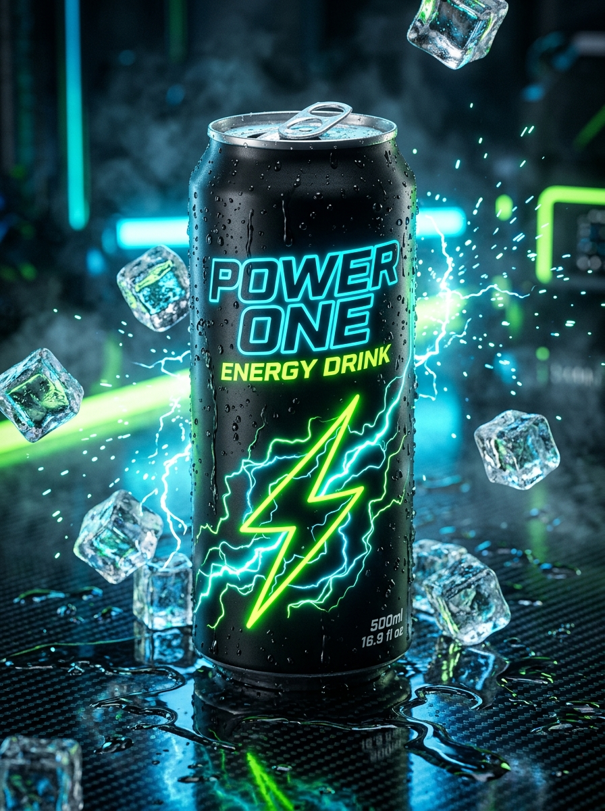

# ⚡ POWER ONE — High-Voltage Clean Energy Drink

A next-generation brand website for **POWER ONE Clean Energy Drink**, built with React, Vite, and Tailwind CSS.



## 🚀 Features

- **Dynamic 3D Can Showcase**: Mouse-tracking perspective tilt with responsive ambient lighting glows that adapt to each flavor.
- **4 Signature Flavors**:
  - ⚡ **Electric Volt**: Crisp Lime & Botanical Citrus (Flagship)
  - 🍇 **Cyber Berry**: Wild Blackberry & Electric Blue Raz
  - 🥭 **Solar Flare**: Ripe Golden Mango & Blood Orange
  - ❄️ **Arctic Zero**: Glacier Blue Citrus & Sub-Zero Mint (0 Calories, 0g Sugar)
- **Web Audio Synthesizer**: Can crackle/fizz, voltage surges, and cart chimes synthesized with zero external audio assets.
- **Interactive Energy Quiz**: 3-step diagnostic matching users to their ideal formula with an unlocked **15% discount code** (`QUIZ15`).
- **Interactive Slide-Out Cart**: Free shipping threshold meter ($45 limit), promo code validation (`POWER20`), and confetti celebration checkout.
- **FDA Nutrition Facts Modal**: Supplement facts panel breakdown of 200mg green tea caffeine, Suntheanine® L-Theanine, Alpha-GPC, and Himalayan pink salt.
- **Verified Reviews & Store Locator**: Search cooler locations across major US metro areas.

## 🛠️ Local Development

```bash
# Install dependencies
npm install

# Start development server
npm run dev

# Build for production
npm run build
```

## 📦 Tech Stack

- **React 19**
- **Vite 8**
- **Tailwind CSS v4**
- **Lucide Icons**
- **Canvas Confetti**
- **Web Audio API**
